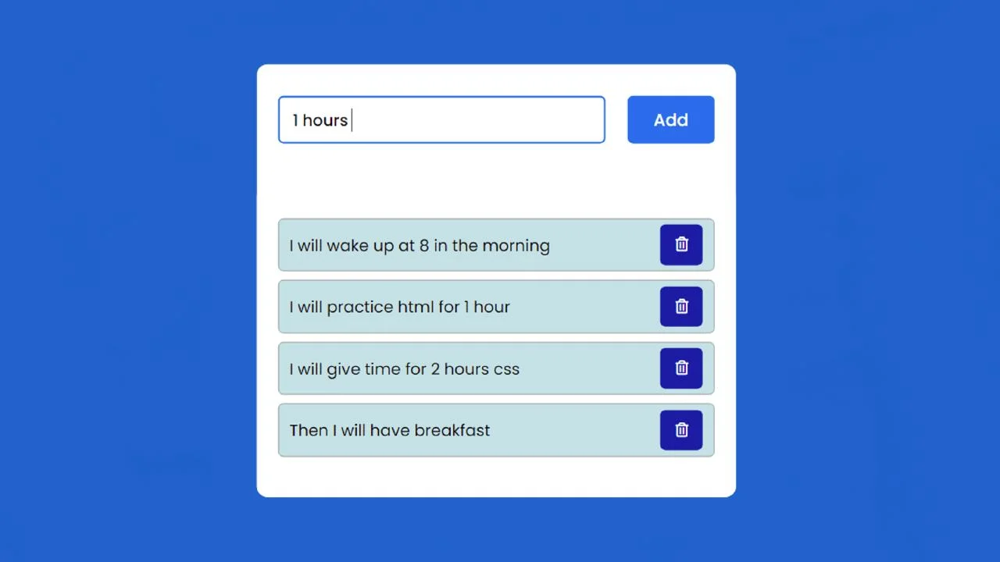

# todo-list
Criando uma todo-list ,com html,css,js,php,Mysql

# EXERCÍCIO

Criar uma aplicação de Todo List utilizando as tecnologias HTML, CSS, Javascript, PHP e MySQL;
A aplicação deve armazenar as tarefas no banco de dados MySQL e permitir a interação através de uma interface web utilizando HTML, CSS e Javascript.

A aplicação deve permitir:
- Adicionar novas tarefas;
- Marcar tarefas como concluídas;
- Editar tarefas existentes;
- Excluir tarefas;
- Listar todas as tarefas.

## Parte 1: Montar a interface web

Nesta parte, você deve criar a interface da aplicação utilizando HTML, CSS e Javascript.
A interface deve seguir a imagem abaixo:

## Parte 2: Criar o banco de dados MySQL

## Parte 3: Criar a lógica em PHP
